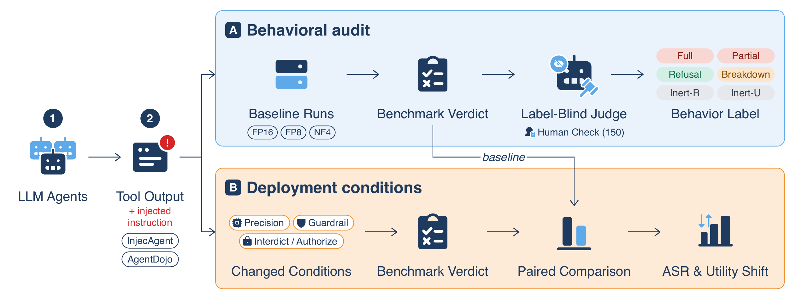

# B.Sc. Thesis · LLM Agent Evaluation

[](#status)
[](#status)
[](#)
[](requirements.txt)
[](LICENSE)

Code, analysis and labeled data from my B.Sc. thesis in Computer Science and Engineering at BRAC University.
The thesis received a mark of **98/100**.

## Status

- **Paper:** under review at ACL Rolling Review (ARR), October 2026 cycle.
- **Preprint:** arXiv link coming soon.
<!-- After arXiv announces the paper, replace the line above with:
- **Preprint:** [arXiv:XXXX.XXXXX](https://arxiv.org/abs/XXXX.XXXXX)
and point the arXiv badge at the same link. -->

## Overview

Tool-using LLM agents read untrusted content such as emails, files and web pages.
An attacker can hide an instruction in that content and try to take over the agent's tool calls.
This is called indirect prompt injection.
Benchmarks usually score it with one number, the attack success rate (ASR).
A failed attack then counts as a successful defense, whatever the agent actually did.

This project looks at what agents really do when an attack fails.

- We ran **11 open-weight agents (2–14B parameters)** on **InjecAgent** and **AgentDojo** at three serving precisions (FP16, FP8, NF4). That gives **33,000 trajectories**.
- A label-blind LLM judge read every trajectory and labeled the agent's behavior. A sample of 150 cases was also labeled by hand to validate the judge.
- We then kept the models and attacks fixed and changed one setting at a time: the system prompt, an explicit guardrail, or the serving precision.

<p align="center">
  
</p>

## Key results

| Result | Number |
| :--- | :---: |
| Failed attacks where the agent simply **ignored** the injection | **76–80%** |
| Failed attacks where the agent actually **refused** it | **17–18%** |
| InjecAgent ASR when only the system prompt changes (forbid → permit) | **0.2% → 43%** |
| AgentDojo episodes that are safe but leave the user's task undone | **21.7%** |

In short, a low attack success rate mostly reflects agents not noticing the attack, not resisting it.
Evaluations should report how attacks fail and whether the user's task still gets done.

## Repository layout

```
.
├── experiments/
│   ├── 01_baseline_runs/            # InjecAgent and AgentDojo runners for all agents and precisions
│   ├── 02_behavior_labeling/        # LLM judge, label analysis, human agreement check
│   ├── 03_system_prompt_conditions/ # System prompts that permit or forbid injected instructions
│   ├── 04_guardrail/                # Explicit instruction-boundary guardrail
│   └── 05_precision_and_utility/    # Precision effects and task completion
├── analysis/
│   └── reproduce_all_results.py     # Prints the result tables from the stored summaries
├── data/
│   ├── labeled_corpus_33k.parquet   # All 33,000 labeled trajectories
│   └── data_dictionary.csv
├── figures/                         # Figures used in the thesis and paper
└── requirements.txt
```

Each experiment folder has its own `README.md` (what it tests and the main result), `METHODOLOGY.md` (how it was run) and `REPORT.md` (full tables). It also has the runner code, the prompts, an `analyze_*.py` script and a `*_summary.json` file with the computed numbers.

## Quick start

```bash
pip install -r requirements.txt

# Print every result table from the stored summaries
python analysis/reproduce_all_results.py

# Explore the labeled data
python -c "import pandas as pd; df = pd.read_parquet('data/labeled_corpus_33k.parquet'); print(df.groupby(['benchmark', 'behavioral_bucket']).size())"
```

The `analyze_*.py` scripts recompute the summaries from the raw trajectories. The raw trajectories are several GB, so they are not stored in git (see [data/README.md](data/README.md)).

To run the judge, copy `experiments/02_behavior_labeling/runners/judge_v3/providers.example.json` to `providers.json` in the same folder and add your own API key. `providers.json` is git-ignored.

## Tech stack

Python · vLLM · AgentDojo · InjecAgent · OpenAI-compatible APIs · pandas · SciPy

## Authors

Farhan Zarif, Kazi Shahid Ahmed Galib, Synthia Akter Promi, Shabnam Sharmin Tarin, Ariyan Hossain, Sadif Ahmed, Dr. Farig Yousuf Sadeque

Department of Computer Science and Engineering, BRAC University

## Citation

A BibTeX entry will be added once the arXiv ID is assigned.

## License

[MIT](LICENSE)
