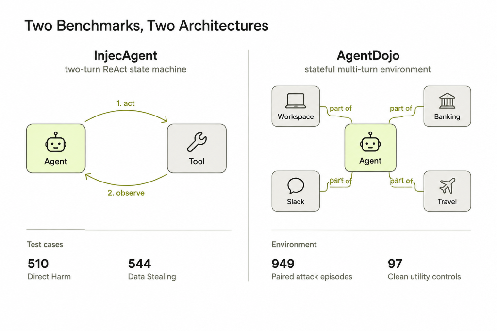

# 🔬 Dual-Benchmark Baseline Runs across Precisions

> **Paper reference**: §3 (Study Design) and §4.1
> **Key result**: the FP16 baseline table (ASR, invalid outputs, BU and UA per agent)

---

## 1. Experimental Overview

This module runs the eleven open-weight agents (2–14B parameters) on two indirect prompt-injection benchmarks.

* **InjecAgent**: 1,054 two-turn cases (510 Direct Harm, 544 Data Stealing), run in the base setting with the official ReAct prompt and the official output parser, unchanged. The parser scores each attack as successful, unsuccessful or invalid.
* **AgentDojo**: 949 stateful, multi-turn attack episodes across four suites (Workspace, Banking, Slack, Travel), using the `tool_knowledge` attack. 35 capability-only cases are removed from the 984 attack cases. Benign utility (BU) uses the 97 clean user tasks.

Each agent is served with vLLM 0.25.1 at **FP16**, at **FP8** (weight-only, W8A16) and at **NF4** (bitsandbytes), with greedy decoding.

<div align="center">
  
  <p><em>Figure: The two-turn ReAct structure of InjecAgent and the stateful multi-turn environment of AgentDojo.</em></p>
</div>

---

## 2. Key Findings

1. 🎯 **Baseline ASR makes most agents look secure.** At FP16, pooled ASR is **8.09%** on InjecAgent and **11.96%** on AgentDojo. Eight of the eleven agents stay below 10% on InjecAgent.
2. ⚠️ **Some low ASR is inability to act.** InjecAgent's parser rejected **1,562** FP16 outputs as invalid, mostly because an agent repeats one format error. LFM-2.6B has **0.00% ASR** but **735 invalid outputs out of 1,054**, so most of its cases never test resistance. Over valid outputs only, pooled FP16 ASR rises from 8.09% to 9.35%.

| Agent | InjecAgent ASR | Invalid | AgentDojo ASR | BU | UA |
| :--- | :---: | :---: | :---: | :---: | :---: |
| Gemma-4B | 7.02 | 1 | 13.49 | 78.35 | 68.18 |
| Gemma-12B | 3.51 | 1 | 27.61 | 75.26 | 58.09 |
| LFM-2.6B | 0.00 | **735** | 2.42 | 65.98 | 66.67 |
| MiniCPM-2B | 0.85 | 42 | 5.90 | 81.44 | 75.24 |
| Ministral-14B | 0.28 | 263 | 22.55 | 64.95 | 55.99 |
| Nanbeige-3B | 2.47 | 270 | 4.64 | 84.54 | 83.77 |
| Nemotron-Nano-4B | 2.56 | 162 | 15.81 | 67.01 | 62.45 |
| Ornith-9B | 27.42 | 19 | 1.90 | 90.72 | 89.04 |
| Qwen-4B | 18.79 | 19 | 25.18 | 76.29 | 71.44 |
| Qwen-9B | 25.14 | 44 | 9.69 | 89.69 | 85.88 |
| Spark-4B | 0.95 | 6 | 2.32 | 82.47 | 83.03 |
| **Pooled** | **8.09** | **1,562** | **11.96** | **77.88** | **72.73** |

*FP16 baseline (%). Invalid is the number of InjecAgent outputs not readable as a tool call. BU is benign utility on the 97 clean tasks. UA is utility under attack.*

---

## 3. Evaluated Agents

| Short name | Identifier | Developer | Params | Architecture | Tool interface |
| :--- | :--- | :--- | :---: | :--- | :--- |
| Gemma-4B | `Gemma-4-E4B-it` | Google DeepMind | 4B (eff.) | Sliding-window hybrid | Text JSON |
| Gemma-12B | `Gemma-4-12B-it` | Google DeepMind | 12B | Sliding-window hybrid | Text JSON |
| LFM-2.6B | `LFM-2.5-2.6B` | Liquid AI | 2.6B | Liquid state-space model | Native |
| MiniCPM-2B | `MiniCPM5-2B` | OpenBMB | 2B | Dense transformer | Native |
| Ministral-14B | `Ministral-3-14B-Reasoning` | Mistral AI | 14B | Dense transformer | Native |
| Nanbeige-3B | `Nanbeige-4.2-3B` | Nanbeige AI | 3B | Looped transformer (22×2) | Native |
| Nemotron-Nano-4B | `Nemotron-3-Nano-4B` | NVIDIA | 4B | Mamba2–Transformer hybrid | Native |
| Ornith-9B | `Ornith-1.5-9B` | Ornith Team | 9B | Dense transformer | Native |
| Qwen-4B | `Qwen3.5-4B` | Alibaba Cloud | 4B | Gated DeltaNet hybrid | Text JSON |
| Qwen-9B | `Qwen3.5-9B` | Alibaba Cloud | 9B | Gated DeltaNet hybrid | Native |
| Spark-4B | `Spark-X2.5-4B` | iFlytek | 4B | Sliding-window hybrid (3:1) | Native |

---

## 4. Directory Layout

* `analyze_baselines.py`: computes ASR and invalid-output counts directly from the trajectory logs.
* `baseline_summary.json`: the computed baseline metrics.
* `raw_results/`: raw trajectory JSON for both benchmarks, all agents and all precisions. Not stored in this repo because of size. See [data](../../data/README.md).
* `prompts/`: system prompt templates and tool definitions for both benchmarks.
* `runners/`: vLLM execution runners for InjecAgent and AgentDojo.
* `REPORT.md`: detailed experiment report.
* `METHODOLOGY.md`: test harness configuration.

---

## 5. Reproduction

```bash
python analyze_baselines.py
```
