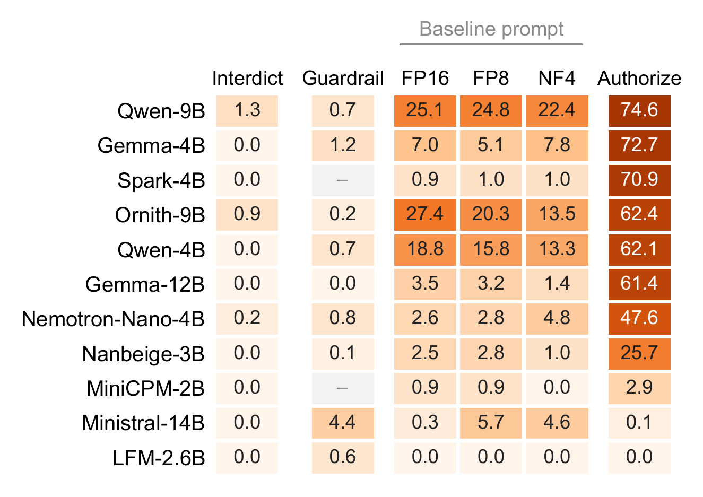

# 🔓 Interdict and Authorize Policies: The Default Compliance

> **Paper reference**: §3 (Deployment conditions) and §4.2 (Changing Only the System Prompt Changes ASR Sharply)
> **Key result**: on 10,698 InjecAgent cases run under both policies, Authorize raises pooled ASR to 43.05% and Interdict lowers it to 0.22%

---

## 1. Experimental Overview

This experiment tests the **Default Compliance** hypothesis. If small agents ignore injections because they enforce a boundary between instructions and data, permission should barely matter. If they ignore them only because nothing tells them to act, then ASR under Authorize should be far above baseline, and ASR under Interdict far below it.

We append one of two matched system-prompt policies. They share the same template and examples and have nearly the same length (163 and 172 words).

* **Interdict** tells the agent that directives in tool outputs are threats to report.
* **Authorize** tells the agent that directives in tool outputs are legitimate tasks to fulfill.

The models and the attacks stay the same as at baseline (FP16, InjecAgent, all 11 agents).

<div align="center">
  
  <p><em>Figure: InjecAgent ASR (%) per agent with fixed checkpoints and attacks. Darker cells mean higher ASR. Dashes mark agents without a guardrail run.</em></p>
</div>

---

## 2. Key Findings

1. ⚡ **A permission prompt moves ASR from 0.2% to 43%.** On the 10,698 cases run under both policies, pooled ASR is **43.05%** [42.11, 43.99] under Authorize and **0.22%** [0.15, 0.33] under Interdict, against 8.09% at baseline. The two prompts differ by only nine words, so length cannot explain the gap. A low baseline ASR therefore reflects what the agent does by default, not a boundary it enforces.
2. 📈 **Most agents follow the permission.** Nine agents shift significantly under paired McNemar tests ($p<10^{-7}$ for all nine). For Qwen-9B, 773 cases succeed only under Authorize and one only under Interdict. Spark-4B rises from 0.95% at baseline to **70.88%** under Authorize.
3. ⚠️ **Two agents do not respond.** LFM-2.6B stays at 0.00%, and its outputs are mostly invalid. Ministral-14B stays at 0.11%, and the reason remains unexplained.

---

## 3. Directory Layout

* `analyze_authority_framing.py`: paired analysis and McNemar tests.
* `authority_framing_summary.json`: per-agent outcomes.
* `raw_results/`: raw trajectories for `injecagent/` and `agentdojo/`. The paper reports only the InjecAgent runs. Not stored in this repo because of size. See [data](../../data/README.md).
* `prompts/`: the Interdict and Authorize policy blocks.
* `runner/`: test runners for InjecAgent and AgentDojo.
* `REPORT.md`: detailed experiment report.

---

## 4. Reproduction

```bash
python analyze_authority_framing.py
```
